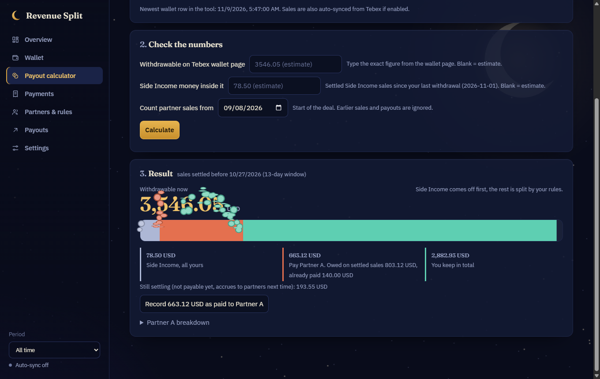
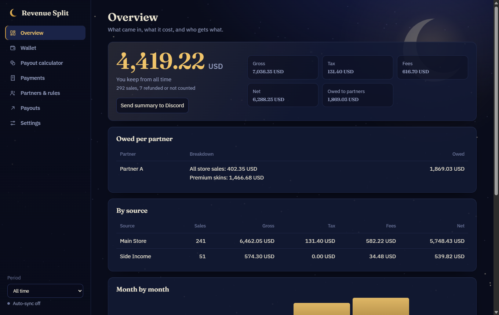
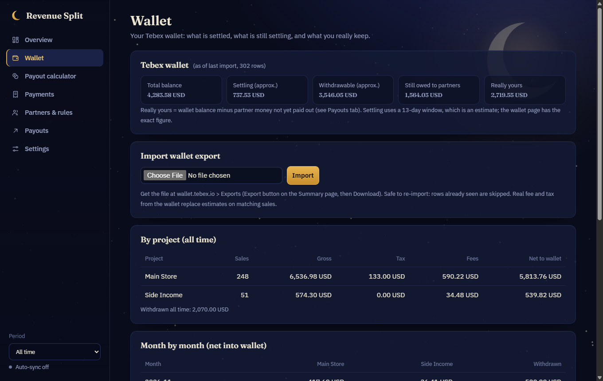

# Revenue Split

**A local payout calculator for Tebex stores.** It shows what you actually earn after tax and fees, how much of it has settled, and exactly how much to pay each revenue-share partner, down to the item in the basket.



Built for game server owners who sell through [Tebex](https://www.tebex.io/), pay partners a percentage (for example a model or plugin creator), and get stuck on payout day because Tebex holds new sales for roughly two weeks before they can be withdrawn.

> Everything runs on your computer. There is no account, no server, and no telemetry. Your sales data never leaves your machine, apart from the calls the app makes to Tebex and to the Discord webhook you set up yourself.

## What it does

- **Real money, not guesses.** Imports your Tebex wallet export and uses the real sales tax, platform fee and gateway fee for each sale. The Tebex API gives no fees, so sales it finds before the wallet export arrives use an estimate you can tune.
- **Payout calculator.** Press one button on payout day. It takes the money that has *settled*, takes out income that is entirely yours first, and splits the rest by your partner rules. Anything that does not fit carries over to next month.
- **Item-level partner rules.** "60% of any item containing `skin`, plus 7% of all store sales." When someone buys a skin and a rank in one basket, the 60% applies only to the skin's share, not the whole basket.
- **Several income sources in one wallet.** A single Tebex wallet can receive money from more than one store. The wallet export says which store each sale came from, so you can keep them apart and mark a source as all yours.
- **Auto-sync from Tebex.** Optional. Pulls new payments from the Tebex API every few minutes and tracks refunds.
- **Discord alerts.** Posts an embed for every new sale, highlights items you care about, and shows what each partner is owed after it.
- **Payout ledger.** Record what you pay partners, so what you still owe is always right.
- **Desktop app on Windows.** An app-style window, a shortcut, and a background task that opens the calculator on the 1st of every month.

| Overview | Wallet |
|---|---|
|  |  |

## Quick start

You need [Node.js](https://nodejs.org/) 18 or newer. There is nothing to `npm install`.

```bash
git clone https://github.com/OWNER/revenue-split.git
cd revenue-split
npm run demo      # try it with generated fake data, on http://localhost:3378
npm start         # run it for real, on http://localhost:3377
```

### Windows desktop app

```powershell
powershell -ExecutionPolicy Bypass -File .\install-windows.ps1
```

This adds a "Revenue Split" shortcut (Desktop and Start Menu) that opens the app in its own window, using Edge or Chrome you already have. It also registers a per-user scheduled task that starts the server quietly at login, so syncing and Discord alerts keep running, and opens the payout calculator on the 1st of each month. No admin rights needed. Remove it with `uninstall-windows.ps1`; your data is left alone.

## Setting it up

1. **Settings > Sources.** Name your income sources, set an estimated fee, and tick "All mine" for any source whose money is entirely yours.
2. **Partners & rules.** Add each partner and their rules. A rule pays a percentage of a sale's net (or gross) when an item name contains your keywords. Rules stack.
3. **Wallet.** In your Tebex wallet go to *Exports*, create an export, download it, and import it on the Wallet tab. Map each store in the file to one of your sources.
4. **Optional: Tebex auto-import.** In Settings, paste the **game server secret key** from your Tebex panel and choose a sync interval.
5. **Optional: Discord alerts.** In Discord: channel settings, Integrations, Webhooks, New Webhook, Copy URL. Paste it into Settings.
6. **Payout calculator.** Set "Count partner sales from" to the first day your deal covers and record any payouts you already made.

## How the payout maths works

On payout day, with `settled` meaning sales older than the settling window (13 days by default):

1. Start from the **withdrawable** amount. Type the exact figure from the Tebex wallet page, or use the estimate.
2. Subtract income from **all-mine sources**. It is yours and never shared.
3. What is left is store money, already after tax and fees.
4. Each partner is owed their rules applied to **settled** store sales, minus what you have already paid them.
5. They are paid from the store money, capped at what is available. Any shortfall carries over.
6. You keep the rest. Sales that are still settling accrue to partners next time.

## Where your data lives

| What | Where |
|---|---|
| Sales, wallet, settings, Tebex key, webhook URLs | `%APPDATA%\RevenueSplit\db.json` (Windows) or `~/.revenue-split/db.json` |

It is kept outside the project folder on purpose, so it cannot be committed by accident. The Tebex key and webhook URLs are never sent back to the browser after you save them. The server only listens on `127.0.0.1` and rejects requests from other sites.

Set `DATA_DIR` to use another folder.

## Limits worth knowing

- **Settling is an estimate.** Tebex does not say which wallet rows are still settling. The default 13-day window matched a real wallet to within a few dollars. Always type the exact withdrawable figure from the wallet page when you pay out.
- **Basket splits use typical item prices.** When one payment contains several items, the amount is shared between them by each item's usual price. Items that have never been sold on their own fall back to an equal share.
- **One currency.** Only your main currency (USD by default) is counted. Sales in other currencies are skipped.
- **Wallet exports are manual.** The Tebex wallet has no public API, so you export and import the file yourself. On the Payout calculator tab, one click imports the newest export from your Downloads folder.

## Development

```bash
npm test          # money maths, wallet import, basket splits, Discord alerts
npm run demo      # fake data, safe for screenshots
```

Plain Node.js and plain browser JavaScript, with no build step. [Three.js](https://threejs.org/) (MIT) is bundled in `public/vendor/` for the moon and the coin shower, so the app works offline. Animations respect `prefers-reduced-motion`.

## Disclaimer

This is an independent, unofficial tool. It is not affiliated with or endorsed by Tebex. It is a calculator, not financial, legal or tax advice. Check its numbers against your own records and your agreements before you pay anyone.

## License

[MIT](LICENSE). Three.js is also MIT, see `public/vendor/LICENSE-three.txt`.
